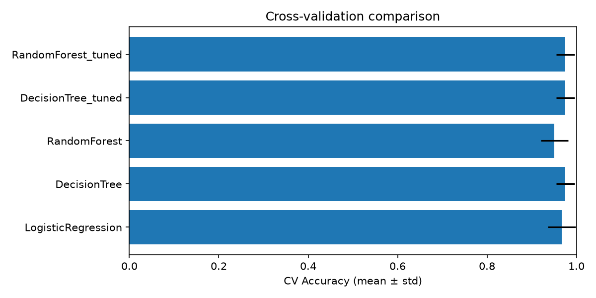
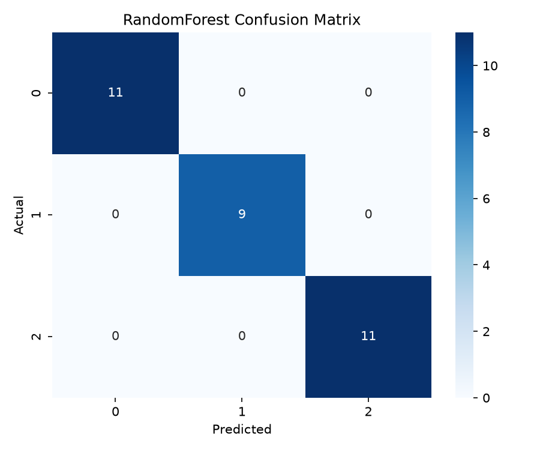
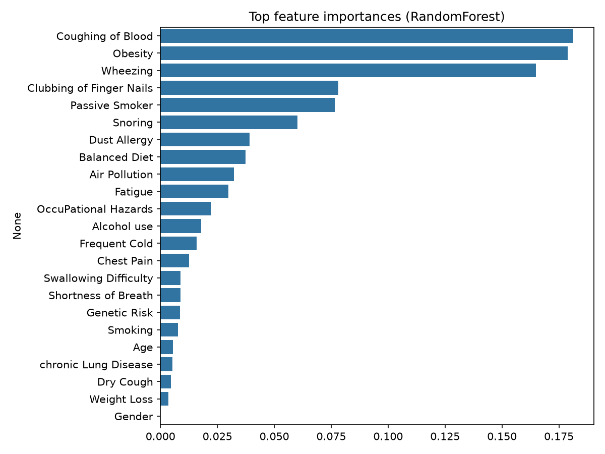

# Lung Cancer Risk Prediction

Classifies patients into **Low / Medium / High** risk from 23 lifestyle and symptom
features, comparing Logistic Regression, Decision Tree, and Random Forest with
stratified cross-validation and hyperparameter tuning.

## Results

Cross-validation (5-fold stratified, training set of 121 rows) and held-out test
results (31 rows):

| Model                 | CV Accuracy (mean ± std) | Test Accuracy | Macro Recall | Macro F1 |
| --------------------- | ------------------------ | ------------- | ------------ | -------- |
| Logistic Regression   | 0.967 ± 0.031            | 0.968         | 0.970        | 0.967    |
| Decision Tree (tuned) | 0.975 ± 0.020            | 1.000         | 1.000        | 1.000    |
| Random Forest (tuned) | 0.975 ± 0.020            | 1.000         | 1.000        | 1.000    |

Baseline (untuned) CV accuracy: Logistic Regression 0.967, Decision Tree 0.975,
Random Forest 0.951. Tuning did not meaningfully improve on the defaults.

Class labels in the plots: 0 = High, 1 = Low, 2 = Medium





The most influential features were Coughing of Obesity, Wheezing and Snoring.

## Dataset

1,000 patient records, 23 features (age, gender, environmental exposures, lifestyle
factors, symptoms) and a 3-class target `Level` (Low / Medium / High).

**Data quality finding:** after removing the patient ID, only **152 of the 1,000
rows are unique**. The other 848 are exact duplicates. Duplicates were removed
before splitting, because otherwise identical rows land in both train and test
sets and inflate scores through leakage.

## Method

- Dropped the `Patient Id` identifier and duplicate rows
- Preprocessing (median imputation, scaling, one-hot encoding) inside a
  scikit-learn `Pipeline`, so nothing leaks across CV folds
- Stratified 80/20 train/test split
- 5-fold stratified cross-validation to compare models
- `GridSearchCV` for Decision Tree (90 candidates) and Random Forest (108 candidates)
- Macro recall and macro F1 reported alongside accuracy

## Project structure

```
data/        dataset
src/         training script
outputs/     figures and result tables
```

## Run it

```bash
pip install -r requirements.txt
python src/train.py
```

Outputs (plots, CV and test summaries) are written to `outputs/`.

## Limitations

- Only 152 unique samples, so the 31-row test set is small and test metrics are
  noisy (one misclassification changes accuracy by about 3 points)
- The dataset appears synthetic and very clean; these scores are unlikely to
  carry over to real clinical data
- Tuned CV scores are slightly optimistic because the same folds were used to
  select and score parameters (nested CV would address this)
- Educational project, not a medical tool

## Future work

- Nested cross-validation for unbiased tuned scores
- SHAP-based explainability
- Streamlit demo for interactive predictions
- Validation on a real clinical dataset
